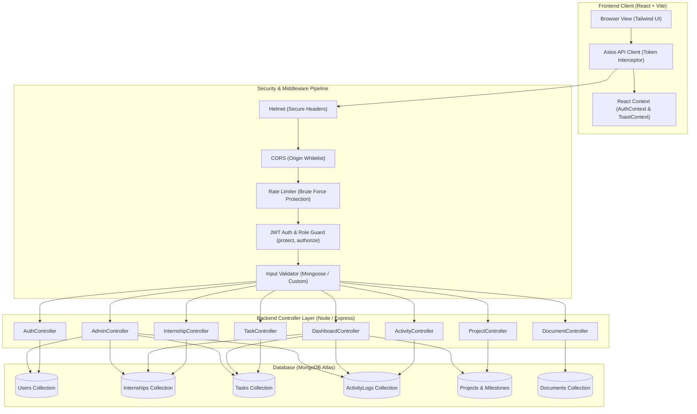

# InternTrack — Student Internship & Project Management Portal

[](https://reactjs.org/)
[](https://nodejs.org/)
[](https://expressjs.com/)
[](https://react.dev/)
[](https://www.mongodb.com/atlas)
[](https://tailwindcss.com/)
[]()
[]()

> A production-grade, responsive full-stack MERN portal engineered for college students, academic supervisors, and corporate mentors to manage student internships, daily activity logs, tasks, project milestones, document attachments, and automated printable progress reports.

---

## 1. Project Overview & Problem Statement

### Problem Statement
College internships and academic capstone projects frequently encounter documentation friction:
- **Dispersed Record Keeping:** Students struggle to maintain chronological records of daily work hours, skills acquired, and blockers encountered across multi-week internships.
- **Unstructured Deliverable Tracking:** Project milestones, repository links, and supervisor reviews are often scattered across emails, spreadsheets, and chat applications.
- **Supervisory Blind Spots:** Academic supervisors lack real-time visibility into whether student tasks align with curriculum learning objectives.
- **Evaluation Bottlenecks:** Compiling formal internship progress reports at the end of the term is tedious, error-prone, and inconsistent in format.

### The Solution: InternTrack
**InternTrack** resolves these challenges by providing a unified, secure, cloud-enabled MERN portal. Students track their active placement, maintain a Kanban task board, record verified daily work logs, organize project milestones with live progress indicators, and generate a printable, evaluation-ready **Internship Progress Report** formatted for college evaluation and summer internship submission.

---

## 2. Target Users & Personas

1. **College Student Interns:**
   - Document daily internship hours, skills, and technical challenges.
   - Organize individual deliverables using an interactive Kanban task board.
   - Break semester-long projects into trackable milestones with progress bars.
   - Export print-ready evaluation reports to claim academic internship credits.

2. **Academic Supervisors & Faculty Mentors (Admin Role):**
   - Access a protected supervision dashboard with system-wide analytics.
   - Inspect registered student rosters, placement companies, and supervisor contacts.
   - Review and moderate submitted daily work logs with qualitative guidance.
   - Oversee student project milestones and task completion velocities.

---

## 3. Key Objectives, Scope & Deliverables

- **End-to-End Persistence:** Complete CRUD operations persisted directly into MongoDB Atlas via Mongoose models.
- **Secure Authentication & RBAC:** Role-based access control (Student vs. Admin) powered by JWT tokens, bcrypt password hashing, and HttpOnly cookie fallback.
- **Data Isolation:** Strict ownership validation on all student-owned documents, tasks, and activity logs.
- **Interactive Visualizations:** Responsive KPI charts built with Recharts (weekly hours productivity bar charts and task status distributions).
- **Automated Academic Reporting:** Formatted `@media print` progress report view with signature blocks, objectives, findings, and deliverables ready for save-as-PDF.
- **Production Hardening:** Helmet security headers, CORS origin whitelisting, express-rate-limit brute-force protection, centralized error handling, and health-check endpoints.

---

## 4. Technology Stack Architecture

### Frontend
- **Framework:** React 18 with Vite
- **Language:** Modern JavaScript (ES6+ Modules)
- **Styling:** Tailwind CSS (deep navy `#0f1f33`, indigo `#4f46e5`, and teal `#0d9488` color palette)
- **Routing:** React Router DOM v6 with protected routes and role-based guards
- **HTTP Client:** Axios with centralized request/response interceptors and token injection
- **Icons:** Lucide React
- **Data Visualization:** Recharts (ResponsiveContainer, BarChart, PieChart)

### Backend
- **Runtime:** Node.js (v24 LTS compatible)
- **Framework:** Express.js 4.x
- **Database Object Modeling:** Mongoose 8.x
- **Database Engine:** MongoDB Atlas (hosted cloud replica set)
- **Authentication:** JSON Web Tokens (`jsonwebtoken`) + `bcryptjs`
- **Security:** `helmet`, `cors` (explicit origins), `express-rate-limit`
- **File Handling:** `multer` memory storage buffer for serverless compatibility
- **Testing:** Vitest & Supertest

---

## 5. MERN System Architecture & Request Flow



---

## 6. Directory & Folder Structure

```
Final project/
├── .gitignore
├── README.md
├── render.yaml                    # Production Render deployment blueprint
├── package.json                   # Root orchestrator scripts
├── client/
│   ├── .env.example
│   ├── index.html
│   ├── package.json
│   ├── postcss.config.js
│   ├── tailwind.config.js
│   ├── vite.config.js
│   └── src/
│       ├── components/
│       │   ├── common/            # Button, Input, Modal, ConfirmModal, Badge, Skeleton, EmptyState
│       │   ├── layout/            # Navbar, Sidebar, AppLayout, Footer
│       │   ├── dashboard/         # StatCard, ProductivityChart, StatusDistributionChart, UpcomingDeadlines, ActivityTimeline
│       │   ├── tasks/             # TaskModal, TaskCard, TaskKanban, TaskList
│       │   ├── activities/        # ActivityModal
│       │   └── projects/          # ProjectModal, MilestoneModal
│       ├── context/               # AuthContext.jsx, ToastContext.jsx
│       ├── pages/                 # LandingPage, LoginPage, RegisterPage, DashboardPage, InternshipPage,
│       │                          # TasksPage, ActivitiesPage, ProjectsPage, DocumentsPage, ReportPage,
│       │                          # ProfilePage, AdminDashboardPage, NotFoundPage
│       ├── routes/                # ProtectedRoute.jsx, AdminRoute.jsx
│       ├── services/              # api.js, authService, internshipService, taskService, activityService,
│       │                          # projectService, documentService, dashboardService, adminService
│       ├── App.jsx
│       ├── main.jsx
│       └── index.css              # Custom scrollbars and @media print styling
└── server/
    ├── .env.example
    ├── package.json
    ├── src/
    │   ├── config/                # db.js (Mongoose connection & lifecycle handlers)
    │   ├── models/                # User, Internship, Task, ActivityLog, Project, Milestone, Document
    │   ├── controllers/           # auth, internship, task, activity, project, milestone, document, dashboard, admin
    │   ├── routes/                # Express REST routes
    │   ├── middleware/            # auth (JWT & RBAC), errorHandler, validate
    │   ├── scripts/               # seed.js (demo seed), seedAdmin.js (admin provisioning)
    │   ├── utils/                 # logger.js (safe structured console logger)
    │   ├── app.js                 # Express application & middleware chain
    │   └── server.js              # Server bootstrapper & graceful shutdown
    └── tests/
        └── unit_and_integration.test.js
```

---

## 7. Database Collections & Schema Design

| Collection | Key Fields | Indexes & Constraints |
| :--- | :--- | :--- |
| **`users`** | `name`, `email`, `password` (hashed), `role`, `studentId`, `college`, `department`, `phone` | `email: 1` (Unique), password hidden with `select: false` |
| **`internships`** | `student` (ref User), `title`, `company`, `supervisorName`, `supervisorEmail`, `startDate`, `endDate`, `status`, `objectives` | `student: 1` (Indexed), Enums: `Pending`, `In Progress`, `Completed`, `Terminated` |
| **`tasks`** | `student`, `internship`, `project`, `title`, `description`, `priority`, `status`, `dueDate`, `category`, `tags`, `completedAt` | `{student: 1, dueDate: 1}`, Enums: `To Do`, `In Progress`, `Completed`, Priority: `Low`, `Medium`, `High` |
| **`activitylogs`** | `student`, `internship`, `date`, `hoursSpent`, `workCompleted`, `skillsLearned`, `challenges`, `nextSteps`, `status`, `mentorFeedback` | `{student: 1, date: -1}`, Enums: `Submitted`, `Reviewed`, `Needs Revision` |
| **`projects`** | `student`, `internship`, `title`, `description`, `techStack`, `startDate`, `targetCompletionDate`, `status`, `repositoryUrl`, `liveUrl` | `student: 1` |
| **`milestones`** | `project` (ref Project), `student`, `title`, `description`, `targetDate`, `completionPercentage`, `status`, `notes` | `{project: 1, targetDate: 1}` |
| **`documents`** | `student`, `internship`, `title`, `category`, `fileName`, `fileUrl`, `fileType`, `fileSize`, `description` | `student: 1`, Max size 10MB |

---

## 8. REST API Endpoints Specification

### Authentication (`/api/auth`)
- `POST /api/auth/register` — Register student account (rate limited)
- `POST /api/auth/login` — Authenticate and issue JWT token (rate limited)
- `POST /api/auth/logout` — Invalidate session and clear auth cookie
- `GET /api/auth/me` — Retrieve current authenticated user profile
- `PUT /api/auth/profile` — Update contact, student ID, and college details
- `PUT /api/auth/password` — Change password securely with old password verification

### Internship Placement (`/api/internships`)
- `GET /api/internships/me` — Retrieve current student placement record
- `POST /api/internships` — Create or update placement details
- `GET /api/internships/:id` — Get internship details (ownership protected)
- `PATCH /api/internships/:id` — Partially update placement
- `DELETE /api/internships/:id` — Delete placement record

### Task Management (`/api/tasks`)
- `GET /api/tasks` — List tasks with filters (`status`, `priority`, `search`, `sortBy`, `page`, `limit`)
- `POST /api/tasks` — Create task deliverable
- `GET /api/tasks/:id` — Get task by ID (ownership protected)
- `PATCH /api/tasks/:id` — Update task details or change status
- `DELETE /api/tasks/:id` — Remove task (destructive confirmation)

### Daily Activity Logs (`/api/activities`)
- `GET /api/activities` — Get chronological logs with date filters, search, and total hours
- `POST /api/activities` — Log daily accomplishments, hours (0.25–24h), and skills learned
- `GET /api/activities/:id` — Get log details
- `PATCH /api/activities/:id` — Update activity log
- `DELETE /api/activities/:id` — Delete activity log

### Projects & Milestones (`/api/projects`)
- `GET /api/projects` — List projects with calculated milestone completion percentages
- `POST /api/projects` — Create full-stack project tracker
- `GET /api/projects/:id` — Get single project with populated milestones
- `PATCH /api/projects/:id` — Update project metadata
- `DELETE /api/projects/:id` — Delete project and cascade-delete child milestones
- `GET /api/projects/:projectId/milestones` — List milestones under project
- `POST /api/projects/:projectId/milestones` — Add milestone with target date
- `PATCH /api/milestones/:id` — Update milestone progress percentage or status
- `DELETE /api/milestones/:id` — Remove milestone

### Documents (`/api/documents`)
- `GET /api/documents` — List uploaded files and attached cloud links
- `POST /api/documents` — Upload file via Multer or attach external URL
- `DELETE /api/documents/:id` — Remove document record

### Dashboard (`/api/dashboard`)
- `GET /api/dashboard/stats` — Aggregated KPI metrics, weekly productivity, status breakdown, deadlines, and alerts
- `GET /api/dashboard/activity` — Recent activity feed

### Faculty / Admin (`/api/admin`)
- `GET /api/admin/stats` — System-wide aggregate statistics (students, tasks, hours)
- `GET /api/admin/students` — Complete student roster with placement indicators
- `GET /api/admin/students/:id` — Comprehensive student evaluation dossier
- `PATCH /api/admin/activities/:id/moderate` — Faculty approval & feedback on logs
- `PUT /api/admin/students/:id/internship` — Assign or override student placement

---

## 9. Installation & Local Setup Guide

### Prerequisites
- Node.js (v18, v20, or v22+ recommended)
- npm (v9+)
- MongoDB Atlas account (or local MongoDB daemon)

### 1. Clone & Install Dependencies
```bash
# Clone the repository
git clone https://github.com/joseph225755/finalproject.git
cd finalproject

# Install both backend and frontend dependencies
npm run install:all
```

### 2. Configure Environment Variables

**Backend (`server/.env`):**
Create `server/.env` using `server/.env.example`:
```env
PORT=5000
NODE_ENV=development
MONGODB_URI=mongodb+srv://<username>:<password>@cluster0.mongodb.net/interntrack?retryWrites=true&w=majority
JWT_SECRET=your_super_secret_jwt_key_min_32_characters_here
JWT_EXPIRES_IN=7d
CLIENT_URL=http://localhost:5173
ADMIN_DEFAULT_EMAIL=admin@interntrack.edu
ADMIN_DEFAULT_PASSWORD=AdminSecurePass123!
```

**Frontend (`client/.env`):**
Create `client/.env` using `client/.env.example`:
```env
VITE_API_URL=http://localhost:5000/api
```

### 3. Provision Admin & Seed Demo Data (Optional)
```bash
# Seed realistic student, internship, tasks, activities, projects, and milestones
npm --prefix server run seed

# Or provision only an administrator account
npm --prefix server run seed:admin
```

### 4. Run the Application
In separate terminal tabs:

**Tab 1 (Server):**
```bash
npm --prefix server run dev
# Server runs on http://localhost:5000
```

**Tab 2 (Client):**
```bash
npm --prefix client run dev
# Vite client runs on http://localhost:5173
```

---

## 10. Live Deployment & Demo Credentials

* **Live Deployment URL:** [https://finalproject-iub2.onrender.com](https://finalproject-iub2.onrender.com)
* **GitHub Repository:** [https://github.com/joseph225755/finalproject](https://github.com/joseph225755/finalproject)

| Role | Email | Password | Access Capabilities |
| :--- | :--- | :--- | :--- |
| **Student** | `student@interntrack.edu` | `StudentPass123!` | Dashboard, Kanban, Daily Logs, Milestones, Printable Report |
| **Admin** | `admin@interntrack.edu` | `AdminSecurePass123!` | Full Student Roster, Log Moderation, Placement Assignment, System Metrics |

*(Both accounts are pre-configured in the one-click demo login buttons on the Sign In page).*

---

## 11. Testing & Verification Results

### Test Execution
```bash
npm --prefix server test
```

### Verified Test Suite (Vitest)
```
 ✓ tests/unit_and_integration.test.js (15 tests)
   ✓ 1. Health & Server Status Endpoint > GET /api/health returns status ok and uptime
   ✓ 1. Health & Server Status Endpoint > GET /api/non-existent returns 404
   ✓ 2. Security & Password Hashing Logic > bcrypt hashes password with salt & verifies correctly
   ✓ 2. Security & Password Hashing Logic > JWT signs and validates payload
   ✓ 2. Security & Password Hashing Logic > JWT rejects expired or tampered tokens
   ✓ 3. Ownership Verification & Access Control > Allows owner student access
   ✓ 3. Ownership Verification & Access Control > STRICTLY blocks foreign student access
   ✓ 3. Ownership Verification & Access Control > Allows administrator access for moderation
   ✓ 4. Input Validation Middleware > validateRegister rejects invalid inputs
   ✓ 4. Input Validation Middleware > validateLogin validates required credentials
   ✓ 4. Input Validation Middleware > validateTask validates priority and status enums
   ✓ 4. Input Validation Middleware > validateActivity validates hours between 0.25 and 24
   ✓ 5. Centralized Error Handler Middleware > Formats Mongoose DuplicateKey (11000)
   ✓ 5. Centralized Error Handler Middleware > Formats Mongoose CastError (invalid ObjectId)
   ✓ 5. Centralized Error Handler Middleware > Formats JWT TokenExpiredError (401)

Test Files  1 passed (1)
     Tests  15 passed (15)
```

### Production Client Build Verification
```bash
npm --prefix client run build
# Result: 2303 modules transformed, bundle generated in dist/ with zero errors.
```

---

## 12. Deployment to Render & MongoDB Atlas

The repository includes a ready-to-use `render.yaml` infrastructure-as-code specification.

### Deploying via Render Blueprint
1. Push this repository to GitHub.
2. In the [Render Dashboard](https://dashboard.render.com/), click **New +** &rarr; **Blueprint**.
3. Connect your GitHub repository. Render automatically reads `render.yaml` and configures:
   - **Backend Web Service (`interntrack-server`):** Root `server`, Build `npm install`, Start `npm start`.
   - **Frontend Static Site (`interntrack-client`):** Root `client`, Build `npm install && npm run build`, Publish `dist`, SPA rewrite rule `/* -> /index.html`.
4. Add your **`MONGODB_URI`** from MongoDB Atlas in the backend service environment variables.
5. In MongoDB Atlas, ensure **Network Access** allows `0.0.0.0/0` (or Render's outbound IP ranges).

---

## 13. ICT Academy of Kerala Summer Internship Report Summary

*This section fulfills the documentation requirements for the ICT Academy of Kerala Summer Internship Submission.*

### Executive Summary
The InternTrack portal was developed as an enterprise-grade full-stack solution to address documentation gaps in academic student internships. Built on the modern MERN stack, the application establishes a cohesive digital environment where student interns maintain verifiable daily work logs, organize deliverables via an interactive Kanban board, track multi-tier project milestones, and export print-friendly evaluation reports. Academic mentors benefit from centralized oversight, moderation controls, and real-time completion analytics.

### Introduction
Industrial internships bridge academic theory with industry practice. However, conventional verification methods—such as manual logbooks and fragmented spreadsheets—impede transparent evaluation. InternTrack was created to provide a centralized web portal that simplifies reporting, enforces data integrity, and enhances accountability between students and institutions.

### Objectives
1. Implement a responsive, user-friendly frontend interface utilizing React, Vite, and Tailwind CSS.
2. Build a secure Node.js/Express RESTful backend reinforced with JWT authentication, role guards, and Helmet security headers.
3. Design a scalable MongoDB Atlas database architecture with reference relationships and compound indexes.
4. Provide students with an interactive Kanban task board, daily activity logger, and milestone tracker.
5. Engineer an automated `@media print` Internship Progress Report generator conforming to college submission standards.

### Scope and Deliverables
- **Role-Based Access Control:** Separate portals for Students and Academic Administrators.
- **Task Management System:** Complete CRUD lifecycle with filtering, search, and Kanban drag transitions.
- **Activity Logging Engine:** Chronological daily log entries with logged hours calculation and mentor moderation.
- **Project & Milestone Module:** Multi-project tracking with tech stack indicators and automated progress calculation.
- **Document Management:** Multi-category resource attachments with validation up to 10MB.
- **Academic Progress Report:** Print-friendly summary with student info, objectives, activities, findings, and signature blocks.

### Methodology
The project adhered to the Agile iterative methodology:
- **Sprint 1 (Architecture & Schemas):** Mongoose schemas design, compound indexing, and REST contracts.
- **Sprint 2 (Security & Backend APIs):** Express routes, JWT signing, rate limiting, and centralized error handling.
- **Sprint 3 (Frontend Engineering):** Tailwind design system, responsive navigation, and React Context state.
- **Sprint 4 (Integration & Visualizations):** Connecting live APIs, Recharts data mapping, and empty-state handlers.
- **Sprint 5 (Quality Assurance & Hardening):** Vitest test suite execution, production build verification, and deployment blueprinting.

### Project Activities
1. Formulated schema relationships between `User`, `Internship`, `Task`, `ActivityLog`, `Project`, and `Milestone`.
2. Implemented strict authorization middlewares verifying user identity and document ownership to eliminate horizontal privilege escalation.
3. Configured Recharts for dynamic calculation of 7-day productivity curves and task distributions.
4. Formatted the Printable Report view with print-only typography and header breaks for flawless PDF generation.

### Results and Findings
- **Security Validation:** Authentication attacks are curtailed via IP rate limiters, while password hashes remain protected through Mongoose field selection locks.
- **Performance:** Vite production builds achieve sub-second client-side route transitions and modular bundle chunking.
- **Data Integrity:** Cascading deletes cleanly remove child milestones when parent projects are deleted, preventing orphan records.

### Conclusion & Future Enhancements
InternTrack provides an end-to-end full-stack solution for academic internship oversight. Future iterations may integrate WebSocket real-time chat between students and mentors, automated weekly reminder emails via SendGrid, and AI-assisted task summarization.

---

## 14. License

This project is licensed under the **MIT License**.
